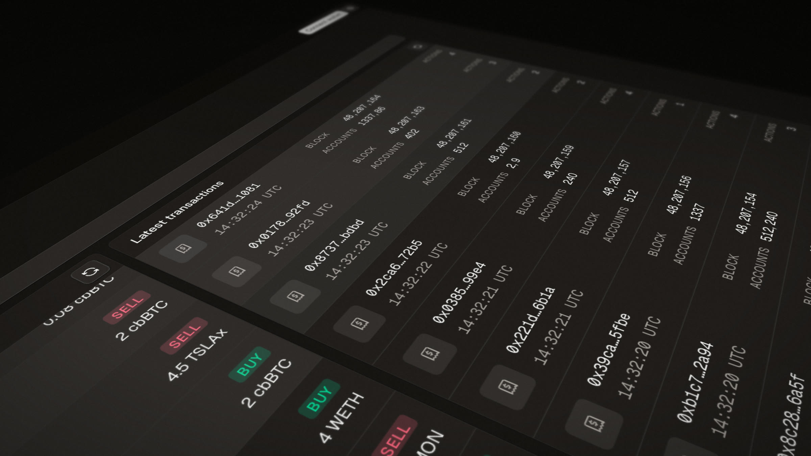
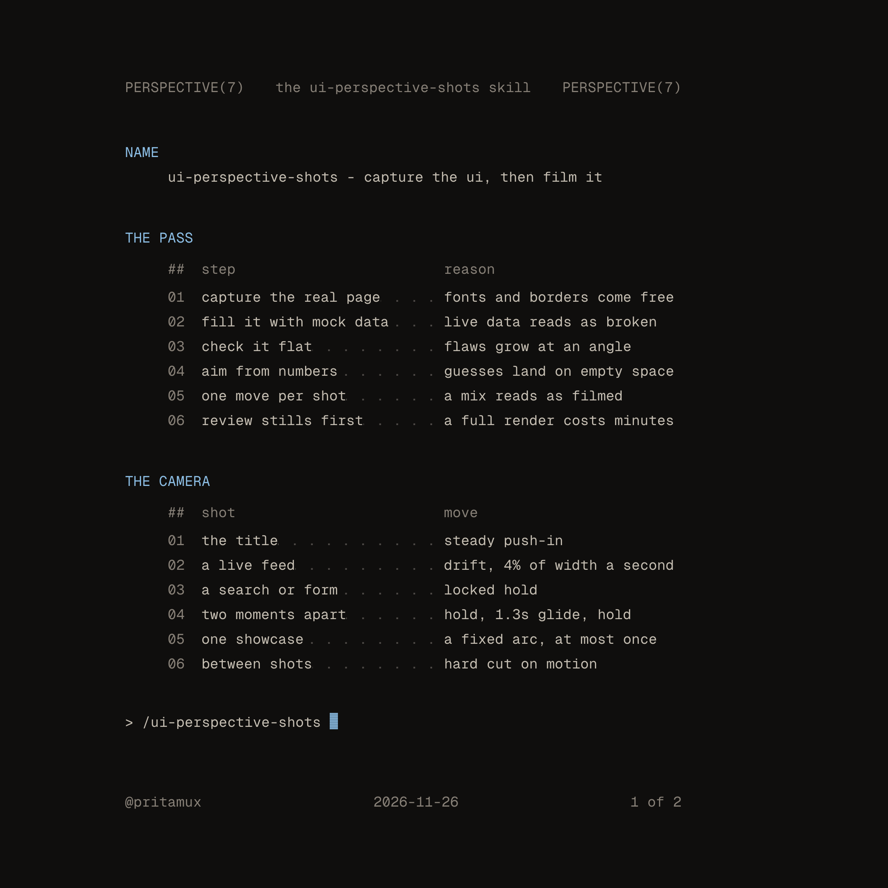
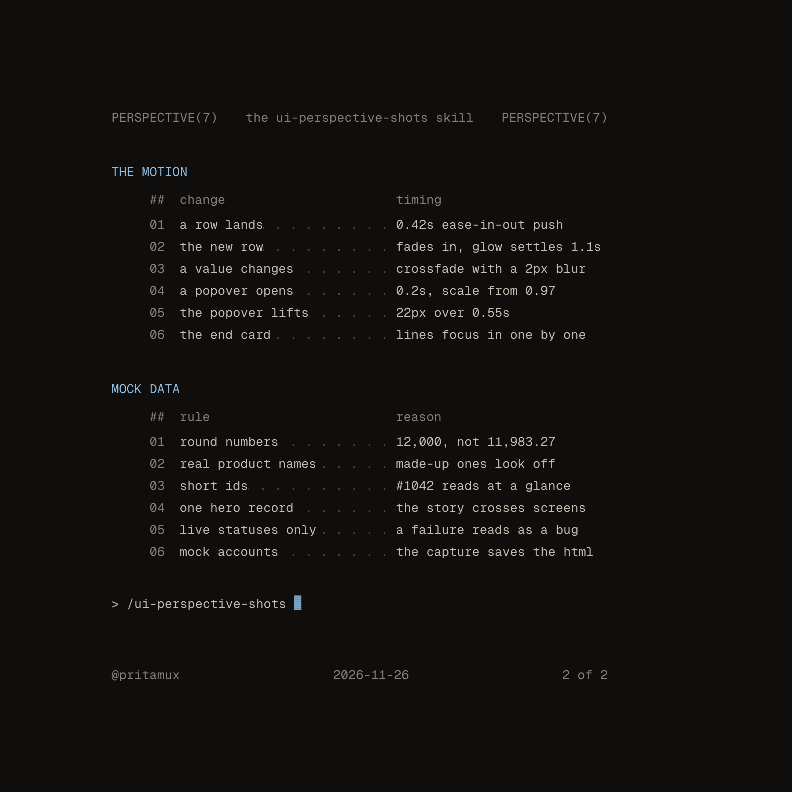

# ui-perspective-shots

An agent skill that films your product's real UI on a tilted plane: depth of field, light falloff and a live interface, rendered frame by frame. It makes one launch video and a set of stills.

Capture the real page, fill it with mock data, then point a camera at it.



## Install

```sh
npx skills add pritamux/ui-perspective-shots
```

Or copy `skills/ui-perspective-shots/` into your agent's skills folder (for Claude Code, `~/.claude/skills/ui-perspective-shots/`).

Then ask your agent for the set, or call it directly:

```
/ui-perspective-shots launch video and stills for the new activity page
```

## What it makes

- One launch video, about 17 seconds at 1080p and 60 fps. A push-in on the title, a drift over the live feed, a hold on the main interaction, one glide on a record, then an end card.
- 5 to 8 stills at 3840×2160 from the same capture.
- Optional reels of camera arcs and macro pans, for separate posts.





## What's inside

| File | What it does |
| --- | --- |
| `skills/ui-perspective-shots/SKILL.md` | The process, the camera decision trees and the motion rules the agent follows |
| `skills/ui-perspective-shots/kit/capture.cjs` | Saves pages, CSS and fonts from a running dev server into `capture/` |
| `skills/ui-perspective-shots/kit/engine.js` | Camera, depth of field, light, grain, tracks, arcs, keyframes, value crossfades, end card |
| `skills/ui-perspective-shots/kit/run.js` | Builds the stage, picks a reel and exposes `frameAt(t)`, `stillAt(n)` and `reelLength` |
| `skills/ui-perspective-shots/kit/stage.html` | The page the renderer loads (copy it to `index.html`) |
| `skills/ui-perspective-shots/kit/render.cjs` | Renderer: frames, stills or H.264 video, one exact frame at a time |
| `skills/ui-perspective-shots/kit/flat.cjs` | Renders each page head-on to check the mock data |
| `skills/ui-perspective-shots/kit/measure.cjs` | Prints element positions for aiming the camera |
| `skills/ui-perspective-shots/kit/motion.py` | Measures camera speed in any video, to compare a cut with a reference |
| `examples/demo-app/` | A small static dashboard to try the kit on |
| `examples/demo-project/` | A complete project for the demo app: data, builders, reels and stills |

## Try it on the demo

Needs Node 18+, Google Chrome, `ffmpeg` and Python 3.

```sh
# 1. Serve the demo app
python3 -m http.server 4173 --directory examples/demo-app &

# 2. Make a project folder from the kit and the demo project
mkdir -p /tmp/shots && cp -r skills/ui-perspective-shots/kit /tmp/shots/kit
cp skills/ui-perspective-shots/kit/stage.html /tmp/shots/index.html
cp examples/demo-project/* /tmp/shots/
cd /tmp/shots && npm i playwright-core

# 3. Capture, check, render
node kit/capture.cjs
node kit/flat.cjs
node kit/render.cjs frames 1,5,9
node kit/render.cjs stills 1,2
node kit/render.cjs video out/demo.mp4
```

`REEL=arcs node kit/render.cjs video out/arcs.mp4` renders the demo's arc reel. `SCALE=2` doubles the resolution (3840×2160) for stills.

## Safety notes

- `capture.cjs` only visits the pages listed in `shots.config.json`, plus the font files their CSS references (which may live on a font CDN). Font filenames are sanitised, and everything it writes stays in `capture/`.
- The capture saves page HTML to disk. Point it at a dev server with mock or disconnected accounts, never a logged-in production session.
- The renderer opens the local stage with `--allow-file-access-from-files`, so the stage can load its own CSS, fonts and data. Only render project folders you created.
- No telemetry, no network calls during rendering, no dependencies beyond `playwright-core` (and `numpy` for `motion.py`).

## Credits

Inspired by Emil Kowalski and the many other great designers and design engineers who share their craft on X.

## License

MIT
